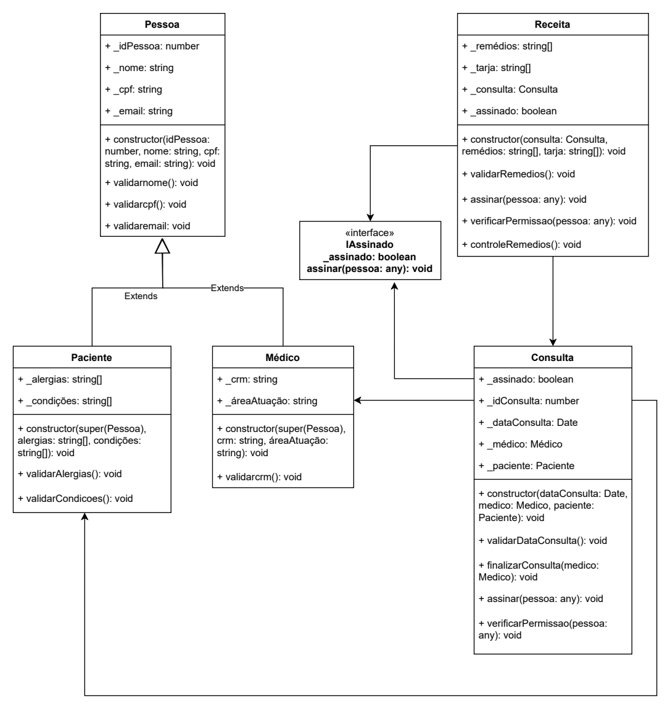

# Programação Orientada a Objetos

*Object-oriented programming coursework in TypeScript with Jest tests: a hospital appointment system, a library system and a TypeORM + MySQL version of the library.*

Trabalhos da disciplina de Programação Orientada a Objetos (UFMT, 2024), feitos em grupo. São classes em TypeScript com herança, interface, encapsulamento e validação dos dados, cobertas por testes em Jest. A última parte leva o sistema da biblioteca para um banco MySQL com TypeORM.



## Projetos

| Pasta | O que é | Testes |
|---|---|---|
| [`lista3-hospital/`](lista3-hospital/) | gerenciamento de consultas: `Pessoa`, `Paciente` e `Medico` (herança), `Consulta`, `Receita` e a interface `IAssinado` para assinar consultas e receitas. Valida nome, CPF, e-mail, CRM, alergias e datas | 30 testes, todos passam |
| [`trabalho-biblioteca/`](trabalho-biblioteca/) | biblioteca: `Autor`, `Livro`, `Genero`, `Exemplar`, `Cliente` e `Emprestimo` (prazo, renovação, devolução e multa) | 17 testes, todos passam |
| [`typeorm-biblioteca/`](typeorm-biblioteca/) | a biblioteca com banco de dados: entidades do TypeORM, repositórios e serviços sobre MySQL | sem testes; o código compila (`tsc`) |
| [`typeorm-exemplo/`](typeorm-exemplo/) | primeiro contato com o TypeORM: uma entidade `Photo` gravada no banco | |
| [`lista3-hospital-rascunho/`](lista3-hospital-rascunho/) | primeira versão da Lista 3, guardada como histórico; os testes dela não compilam mais com as classes | |
| [`sql/`](sql/) | sessão de aula no MySQL: criação de banco e tabelas, chaves estrangeiras e consultas | |

Os dados dos testes (nomes, CPFs e e-mails) são fictícios.

## Como rodar

Precisa do Node.js.

```bash
cd lista3-hospital        # ou trabalho-biblioteca
npm install
npx jest
```

Os projetos com TypeORM precisam de um MySQL rodando em `localhost:3306`, com um banco `typeorm`. O usuário está em `banco.ts` (`poo` na biblioteca, `root` no exemplo) e a senha vem da variável de ambiente `DB_PASSWORD`:

```bash
cd typeorm-biblioteca
npm install
DB_PASSWORD=sua_senha npx ts-node biblioteca.ts
```

O `synchronize: true` faz o TypeORM criar as tabelas a partir das entidades na primeira execução.

## Observações

- Nos testes da biblioteca, a data de devolução era fixa (julho de 2024) e o código recusa datas passadas. Os testes agora usam uma data 30 dias à frente do dia em que rodam.
- Os enunciados, o relatório da Lista 3 e os vídeos de demonstração não estão no repositório.
